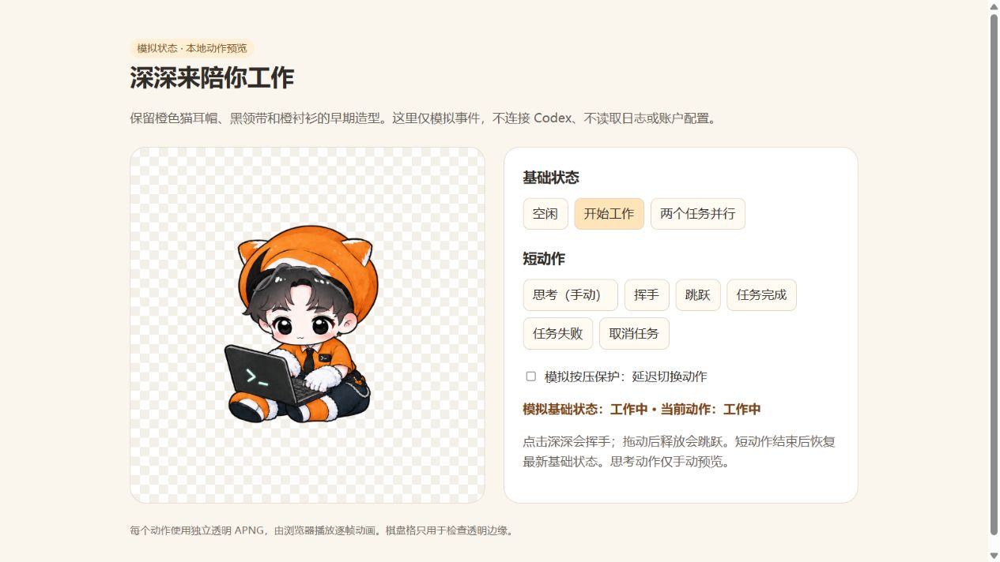

# 深深 · DSH 桌宠

把「深深」放进 DeepSeek Harness：右下角一只跟随任务状态变化的透明角色，**Codex 工作时敲键盘、完成时庆祝、失败时排错、等待你回答时思考**，点击挥手、拖动小跳；同时保留上游 `dsh-whale-widget` 的 API 余额、本机用量、角色、气泡、音效与本地工坊。

本项目是 [MeteorNOX/DeepSeek-Balance-Whale-Widget](https://github.com/MeteorNOX/DeepSeek-Balance-Whale-Widget)（`dsh-whale-widget` 0.4.2）的深深角色分支，角色素材与动作状态机来自 [proletari/shenshen-codex-companion](https://github.com/proletari/shenshen-codex-companion)。



---

## 一、功能

### 1. 深深动作（本分支新增）

| 触发条件 | 动作 | 素材 |
| --- | --- | --- |
| 当前没有活跃回合 | 待机 / 眨眼 | `shenshen-idle.png`（6 帧 APNG） |
| 有活跃回合（`activeTurns > 0`） | 敲键盘 | `shenshen-working.png` |
| 有回合在等你确认/回答（`waiting`） | 思考 | `shenshen-thinking.png` |
| 回合成功结束 | 庆祝，播完回原状态 | `shenshen-celebrate.png` |
| 回合以错误结束 | 排错恢复 | `shenshen-failed.png` |
| 单击角色后松手 | 挥手 | `shenshen-wave.png` |
| 拖动角色未松手 | 奔跑（8 帧，左右两向） | `shenshen-runright.png` / `shenshen-runleft.png` |
| 拖动角色后松手 | 小跳 | `shenshen-jump.png` |

- 7 组 × 6 帧 = **42 帧透明 APNG**，608×608，脚底基线 y=544；另有左右两向各 8 帧奔跑（来自 Codex 自定义宠物 `shenshen-orange-codex` 的图集）。
- 每个动作带一张「全帧 alpha 并集」掩膜：命中凸包与裁切轮廓按并集算，循环中手臂/腿摆出轮廓也不会被裁。
- 裁切轮廓再**横向放宽 1.25 倍**，由 sidecar 直接写入 `clip-path`；宿主的异步 `setupHitTest` 不再决定画面裁切，避免工作帧被待机宽度裁掉。
- 待机 / 敲键盘采用**固定主体**：帽子、身体、脚、电脑不随循环漂移，只更新眼睛与手指区域（与 Codex 版同一套素材与约束）。
- 解码与切换有保护：宿主拖拽/按压期间不换图；自定义角色生效时自动让位，切回默认角色后恢复。
- `waiting` 借用上游已实现的 `ask_user_question` / `approval/asked` 挂起跟踪；没有该信号的旧宿主上不会出现思考态，不影响其它动作。

### 2. 上游功能（完整保留）

- **API 余额**：DeepSeek 官方、OpenRouter、智谱、火山方舟、MiniMax 等多提供商；自动探测 + 手动连接。
- **本机用量**：按 DSH `session/event` 的 `assistant/message` usage 记账，按轮/按天汇总；峰谷计价；不把本机 token 当官方剩余额度。
- **角色**：默认「深深」，支持导入自定义角色图。
- **气泡 / 音效 / 工坊 / 吸附 / 翻转 / 缩放**：与上游一致。
- **隐私**：密钥只存 DSH 凭据（`ctx.credentials`），路由有回环/同源校验；远端请求默认拒绝写操作。

---

## 二、安装

### 前置

- DeepSeek Harness 桌面版或 Web 版（本包按 `desktop` profile 编写说明，Web 用 `--profile web`）。
- DSH 自带的 `dsh` CLI（桌面版位于 `DSH\resources\runtime\cli\bin\dsh.cmd`）。
- **完整退出 DSH**：插件命令需要改 profile 的 `package.json`，应用运行时会被文件锁挡住。

### 安装（公开发行版）

从 GitHub Release 的预构建 tarball 安装（推荐；不需要 npm 账号）：

```powershell
# 先完全退出 DSH
dsh plugin --profile desktop add "https://github.com/proletari/shenshen-codex-companion/releases/download/dsh-v0.1.0/dsh-shenshen-companion-0.1.0.tgz"
# 然后重新启动 DSH
```

如果 `dsh` 不在 PATH，用桌面版自带 CLI：

```powershell
& "<DSH 安装目录>\resources\runtime\cli\bin\dsh.cmd" plugin --profile desktop add "https://github.com/proletari/shenshen-codex-companion/releases/download/dsh-v0.1.0/dsh-shenshen-companion-0.1.0.tgz"
```

npm 包 `dsh-shenshen-companion` 发布后，也可以：

```powershell
dsh plugin --profile desktop add dsh-shenshen-companion
```

### 本地开发安装

```powershell
dsh plugin --profile desktop add "link:<本目录绝对路径>"
```

命令会在 profile 里执行 pnpm add，并把本包自动加入 `dsh.profile.bundles`（本包声明了 `dsh.bundle.patch`）。启动后 DSH 会加载 `cordis.patch.yml`，插件开始工作。

### 安装后的验证清单

1. 打开 DSH，右下角应出现深深（待机眨眼）。
2. 发一条消息：角色切到敲键盘；完成后播放庆祝。
3. 触发一次 `ask_user_question` / 审批：角色切到思考。
4. 单击角色：挥手；拖动后松手：小跳。
5. 打开角色菜单：默认角色名为「深深」；选自定义角色后深深动作停止，切回默认恢复。
6. 菜单里余额、用量、气泡、音效等上游功能仍可用。

### 卸载

```powershell
dsh plugin --profile desktop remove dsh-shenshen-companion
```

或直接删掉 profile `package.json` 里 `dsh.profile.bundles` 的对应项，再 `pnpm remove`。

> ⚠️ 不要同时安装上游 `dsh-whale-widget`：两者会各自注入 `/dsh-whale/widget.js` 与状态路由，出现双角色/双请求。若要并存，先卸掉一个。

---

## 三、它是怎么工作的

```
DSH 页面（Web / Electron 渲染层）
├─ /dsh-whale/widget.js          上游挂件：角色、气泡、菜单、余额/用量面板
├─ /dsh-whale/shenshen-actions.js  本分支新增：动作状态机（sidecar）
└─ .dshwv-img                      两者共同操作的角色 

DSH 宿主进程（Cordis 插件 lib/index.js）
├─ ctx.on('session/event')       折叠 turn/start · assistant/message · turn/end
├─ /dsh-whale/shenshen-status.json  { activeTurns, waiting, notice }
├─ /dsh-whale/shenshen-image.png    7 个 APNG + 左右奔跑 + 全帧掩膜（白名单文件名）
├─ /dsh-whale/shenshen-actions.js   sidecar 脚本
└─ 上游全部路由与逻辑（余额、记账、角色、气泡、音效…）
```

关键点：

- **不改 widget.js 的核心逻辑**：只把默认角色名改成「深深」，动作由 sidecar 观察同一个 `.dshwv-img` 完成。
- **状态来自 DSH 事件**：`lib/shenshen-state.mjs` 是无依赖的纯函数模块，负责 `activeTurns`、子代理过滤、15 分钟兜底清理与 `notice` 去重。
- **注入走两条通道**：Web 用 `ctx.webServer.tapIndex`；桌面壳用 `webserver/index-inject` 的结构化 script 行（桌面壳的 `index.html` 不经过 tapIndex，这是上游踩过的坑）。
- **路由有校验**：复用上游的 `registerRoute` 包装（Host/Origin 回环校验 + 宿主 connection 栅栏）。

### 目录

```
shenshen-dsh-companion/
├─ lib/
│  ├─ index.js            宿主插件（上游 0.4.2 + 深深状态/路由/注入）
│  ├─ shenshen-state.mjs  纯状态折叠（本分支新增）
│  └─ accounting.mjs      上游记账
├─ assets/
│  ├─ whale-widget.js     上游前端（仅角色名改为「深深」）
│  ├─ shenshen-actions.js 动作 sidecar（本分支新增）
│  ├─ shenshen-*.png      7 组 APNG
│  └─ …                   上游角色/气泡/音效
├─ tests/                 状态、动作、插件集成测试
├─ docs/                  预览图与生成 prompt 记录
├─ cordis.patch.yml
└─ package.json
```

---

## 四、开发与测试

```powershell
cd shenshen-dsh-companion

# 语法
node --check lib/index.js
node --check assets/shenshen-actions.js
node --check assets/whale-widget.js

# 测试（无需安装任何依赖）
node tests/shenshen-state.test.mjs
node tests/shenshen-actions.test.mjs
node tests/shenshen-dom.test.mjs
node tests/plugin-integration.test.mjs
```

四组测试覆盖：

- **状态折叠**：turn 开始/结束、成功/失败/取消、子代理过滤、TTL 清理、会话销毁。
- **动作状态机**：7 个动作的 APNG 结构（6 帧、acTL、时长与 manifest 一致）、active/waiting 切换、通知去重、拖拽态、拖拽保护、dispose。
- **事件层回归（假 DOM）**：真实运行 sidecar，模拟单击、拖动、丢失 pointerup、宿主不摘拖拽类、连点，断言每次都会回到 idle，不会卡住。
- **插件集成**：mock Cordis ctx 后真实调用 `apply()`，检查两条注入通道、状态路由、图片/脚本路由、上游路由仍在。

### 修改动作素材

素材来自 Codex 版仓库的 `assets/shenshen-*.png` 与 `shenshen-manifest.json`。替换时保持：

- 608×608、透明、6 帧、APNG；
- 帧时长与 `assets/shenshen-actions.js` 顶部的 `DURATIONS` 一致（思考 1460ms、庆祝 1070ms、失败 1550ms、挥手 1070ms、跳跃 1050ms）；
- 待机/敲键盘的固定主体约束（动区以外像素不变）。

生成用的 prompt 记录在 `docs/shenshen/`。

---

## 五、已知限制

1. **尚未在真实 DSH 实机验证**（开发机已完成语法检查、37 项单元/集成/假 DOM 测试，并在一次性 profile 中验证过 `dsh plugin add`）；注入、桌面壳行、真实事件字段仍需装后确认。
2. **`turn/end.reason` 的取值依赖 DSH 版本**：本包做保守映射（含 error/fail → 失败，含 abort/cancel/interrupt → 取消，其余 → 成功）。若你的版本字段不同，完成/失败动画可能不触发，但不会影响待机/工作/点击/拖动。
3. **思考态依赖上游的挂起跟踪**：`ask_user_question` 与 `approval/asked` 事件不存在时，`thinking` 不会出现。
4. **包体约 21.5MB**：APNG 与掩膜占主要体积，本地 link 安装无影响，发 npm 需注意。
5. **桌面壳注入表只在启动时收集一次**：插件必须在 DSH 启动前就装好；运行期新增/停用插件需要重启 DSH（只改 `assets/` 下的前端文件时，刷新页面即可）。
6. **自定义角色优先**：一旦选择自定义角色，深深动作停止（避免覆盖用户素材）；切回默认恢复。
7. **奔跑帧来自 Codex 自定义宠物图集**（`~/.codex/pets/shenshen-orange-codex`，192×208 单元格放大到 608）：与 608 版 APNG 是同一角色但不同生成批次，切换时画风可能略有差异；拖动方向决定使用左跑还是右跑。
8. **裁切轮廓放宽 1.25 倍**后，角色两侧的透明边距也会落进可点击区域；如果觉得挡住了页面点击，可以把系数调回 1.1 左右。
9. 上游的余额/用量口径边界同样适用：本机观测 ≠ 官方账单，并行/延迟扣费会不准。

---

## 六、更新记录

- **2026-10-17**：修复动作切换后沿用上一动作命中轮廓导致新动作被裁（工作帧显示不全）；拖拽新增空中帧循环；为每个动作生成「全帧 alpha 并集」掩膜，命中/裁切按并集轮廓计算。
- **2026-10-17（二）**：加固点击/拖拽的收尾，避免卡在某个动作——保护态改为「指针按下 + 宿主拖拽类」双条件；`lostpointercapture` 不再误清松手后的待播动作；松手动作有 400ms 兜底；轮询周期性补 flush 自愈；宿主改写角色图后强制重画。新增假 DOM 事件层回归测试（单击/拖动/丢 pointerup/宿主不摘拖拽类/连点）。
- **2026-10-17（三）**：接入用户 Codex 自定义宠物 `shenshen-orange-codex` 图集里的 8 帧跑步动画，按拖动方向使用左右两向（`shenshen-runright.png` / `shenshen-runleft.png`），并生成对应的全帧掩膜；移除原先用 jump 空中帧合成的临时拖拽循环；notice 去重键加入时间戳并持久化，刷新页面不再重播上一轮庆祝；资源 URL 加版本参数避开旧缓存。
- **2026-10-17（四）**：按用户反馈把每个动作的裁切轮廓横向放宽 1.25 倍，并改为 sidecar 预计算、直接写 `clip-path`；宿主 `applyHitClip` 优先采用该轮廓，`setupHitTest` 增加 token 只让最后一次回调生效，修掉工作帧仍被待机轮廓裁切的问题。
- **2026-10-17（五）**：拖动方向改为按「最近一次位移」判断而不是相对按下点，反向累计 5px 即换向；同方向移动时也重算一次镜像，修掉“左拖一段再右拖，方向不换”的问题。

---

## 七、许可与素材

- **代码**：MIT，版权归原作者 MeteorNOX；本分支修改同样以 MIT 发布。
- **美术素材**：`assets/**` 与 `icon.png` **不在 MIT 范围内**，按上游条款 as-is 随插件分发，不授予再许可；深深 APNG 来自 `proletari/shenshen-codex-companion`，奔跑帧来自用户本机 Codex 自定义宠物 `shenshen-orange-codex`，生成 prompt 记录在 `docs/shenshen/`。
- 详见 [PROVENANCE.md](PROVENANCE.md)。若认为素材侵权，请附文件名与依据，核实后立即替换或移除。
